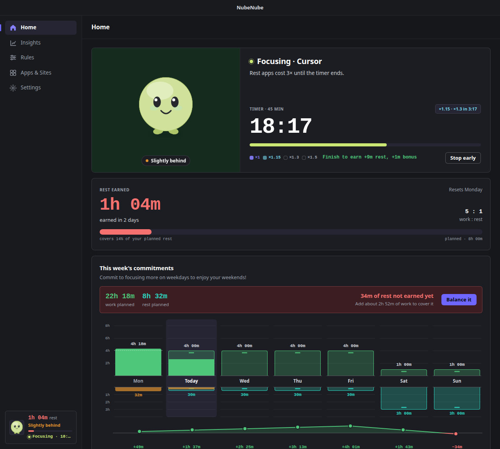
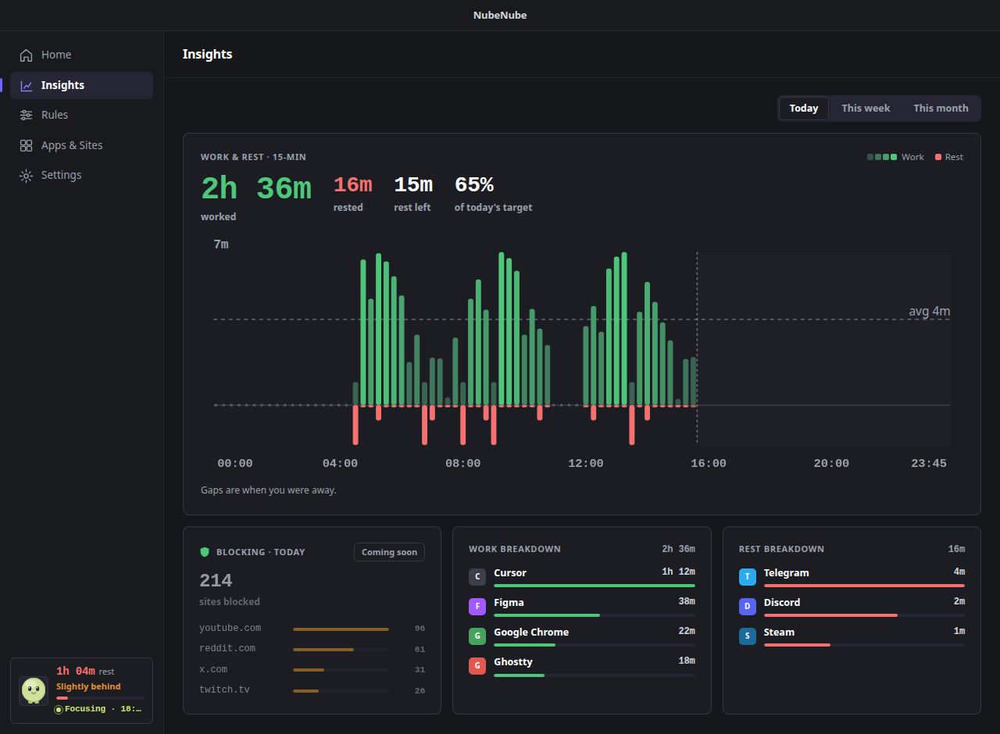
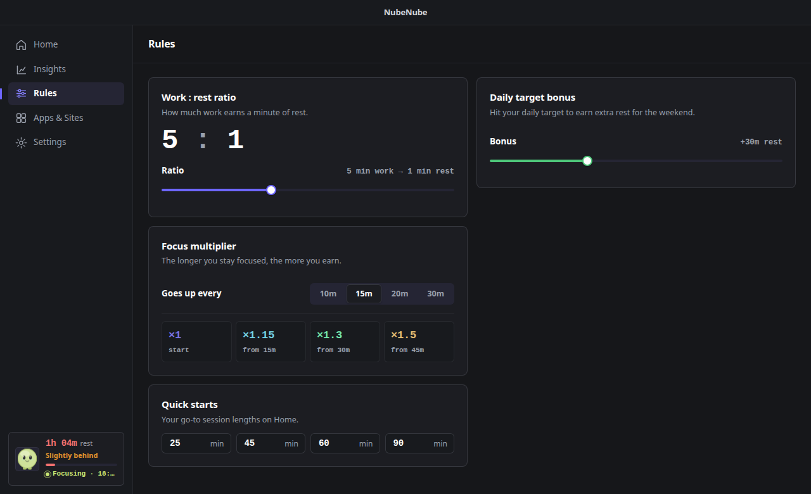
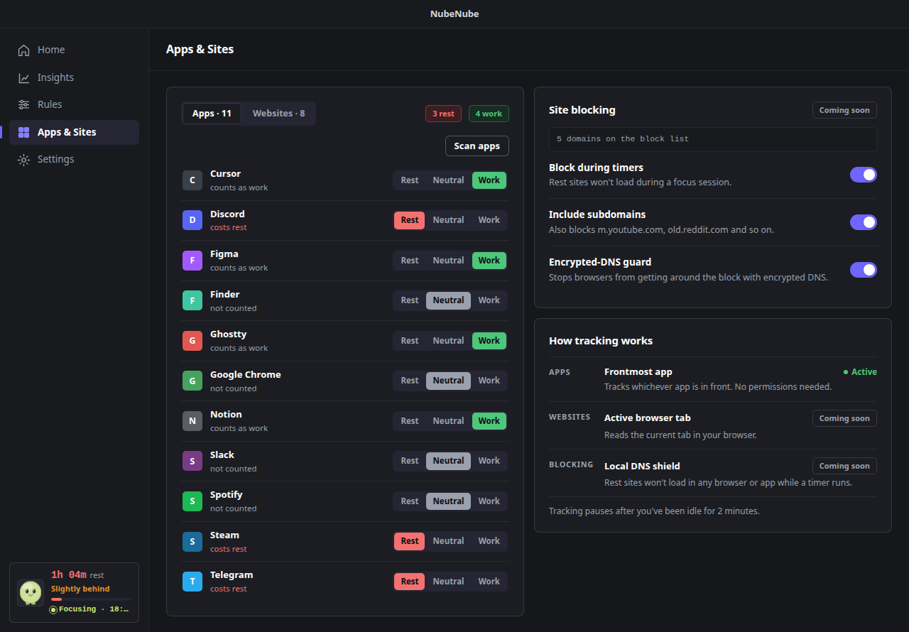
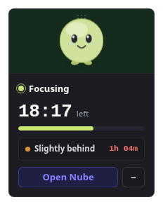
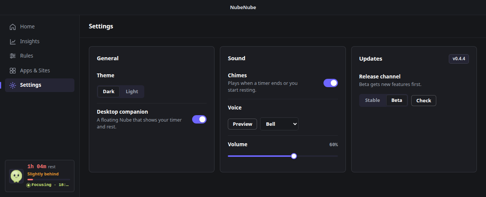

<div align="center">

# NubeNube ☁️

**A desktop focus companion: focus timers earn rest, distractions spend it.**

Set a work target for the day, run focus timers, and bank rest for later. Every few minutes of focus earns a minute of rest; time on a distracting app spends it. A small cloud creature, your *Nube*, shows how the day is going at a glance.

Local-first. No accounts, no servers, no telemetry. NubeNube watches which app is in front and nothing leaves your machine.



</div>

---

## How it behaves

- **Focus earns rest.** Time inside a running timer earns rest at your work:rest ratio (5:1 by default, so 45 minutes of focus earns 9 minutes of rest).
- **Rest apps spend it.** Mark apps as Rest and every minute on them comes out of your bank. Mid-timer it also resets your focus multiplier. The bank can go negative.
- **Long stretches pay more.** Unbroken focus climbs a multiplier (×1.15, ×1.3, ×1.5) every 15 minutes. The bonus is paid when the timer finishes; stopping early forfeits it.
- **Daily targets.** Pick how long you want to work today. Hit it and you earn a bonus. You can raise a target, never lower it.
- **A weekly bank.** Rest accumulates Monday to Sunday and resets each Monday, so focused weekdays buy a lazy weekend.
- **Away isn't distracted.** Idle for 2 minutes and nothing is earned or spent until you're back.

---

## Install

Download the build for your platform from the [Releases page](https://github.com/algebananazzzzz/nubenube/releases):

| Platform | File | Notes |
|---|---|---|
| **macOS (Apple silicon)** | `.dmg` | Drag NubeNube to Applications |
| **Linux (Ubuntu/Debian)** | `.deb` | Install with your package manager |
| **Linux (Fedora/RHEL)** | `.rpm` | Install with your package manager |

**macOS first launch:** the `.dmg` is unsigned for now, so run this once after installing:

```bash
xattr -cr /Applications/NubeNube.app
```

Updates after that install silently.

---

## The screens

### Home

The hero card runs your timer. Pick a quick start (25m, 45m, 1h, 1.5h by default) and the countdown, finish-bonus pips and projected earnings appear. The Nube's colour and mood follow your pace against today's target: *Behind schedule*, *Slightly behind*, *On track*, or *Excellent*.

Below the hero:

- **Rest earned** is this week's bank and how much of your planned rest it covers.
- **This week's commitments** is a planner. Drag the green bars to set today's target and plan work for later days, and the teal bars to plan rest. The line underneath is your running balance; if it dips below zero, **Balance it** spreads the missing work across the remaining weekdays.
- **Today's target** and **Work ratio** tiles summarise the day.

### Insights



Work above the line, rest below, in 15-minute cells for today, 2-hour buckets for the week, or days for the month. Gaps are when you were away. Hover a bar for its numbers and the multiplier you'd reached. The breakdown cards rank the apps you focused in and the apps you rested on.

### Rules



The numbers behind the economy: the work:rest ratio, how often the focus multiplier steps up, your quick-start lengths, and the daily target bonus.

### Apps & Sites



Classify each app as **Work**, **Neutral** or **Rest**. Only Rest changes the economy: Work and Neutral both count as focus inside a timer, and the class is what the Insights breakdowns group by. **Scan apps** adds every app NubeNube has seen in front plus whatever is running now.

Websites work the same way through the Nube Nube extension for Chrome and other Chromium browsers: **Set up** on the Websites tab writes it to disk, then load it from `chrome://extensions` with Developer mode on and **Load unpacked**. The site in your focused tab takes the place of the browser's own class, and while a timer runs, Rest sites (and their subdomains) are blocked. A blocked tab returns to its page when the timer ends.

### Desktop companion



A small always-on-top card that shows the countdown during a timer and your rest bank otherwise, plus today's pace. Drag it by the Nube, collapse it to a pill with **–**, or open the main window from it. It also plays the chimes: one when a timer finishes, one when you start resting.

### Settings



Theme, the desktop companion, chime voice and volume, and the update channel.

---

## How it works

A Rust engine ticks once a second. It reads the frontmost app and your idle time (both zero-permission on macOS; X11 or GNOME's Mutter on Linux), advances the economy, and writes the day to a local SQLite database: one row per day for the bank and plan, 15-minute slots for the Insights graph, and per-app totals. A running timer is saved too, so it survives a restart.

The economy itself (`src-tauri/src/economy.rs`) is a pure function of the timer, today's totals, your rules and what's in front, covered by unit tests.

---

## Build from source

```bash
make install           # system deps + npm install
make dev               # full desktop app with its own dev identifier and data dir
make web               # frontend only, in a browser, against a mock engine
make build             # production bundles
make test              # Rust tests
```

```
src/                  React + TypeScript UI
  pages/              Home, Insights, Rules, Sources, Settings
  components/         AppShell, Companion, NubeCreature, ui
  lib/derive.ts       FocusTick + settings → pace, mood, health, projections
  lib/economy.ts      client mirror of the multiplier and pace rules
  lib/api.ts          Tauri bridge; mock engine outside Tauri
  store/              zustand: focus / settings / prefs / toast / updater
src-tauri/src/        Rust native layer
  economy.rs          the rules (pure, tested)
  engine.rs           1 s tick, timer + plan commands, events
  db.rs               SQLite: days, slots, app time, known apps
  watcher.rs          frontmost app + idle time
  commands.rs lib.rs  IPC, tray, companion window, updater
```

## Releases

- **Beta** (`vX.Y.Z-beta`) is published automatically on every merge to `main`.
- **Stable** (`vX.Y.Z`) is promoted manually via GitHub Actions. Installed apps auto-update silently.

### First-time release setup

Before the release workflow can sign builds, generate a signing keypair:

1. `cargo tauri signer generate -w ~/.tauri/nubenube.key`
2. Copy the public key into `src-tauri/tauri.conf.json` → `plugins.updater.pubkey`
3. Set the real `OWNER/repo` in `plugins.updater.endpoints[0]`
4. Add repo secrets `TAURI_SIGNING_PRIVATE_KEY` (the key file's contents) and `TAURI_SIGNING_PRIVATE_KEY_PASSWORD` (its passphrase)
